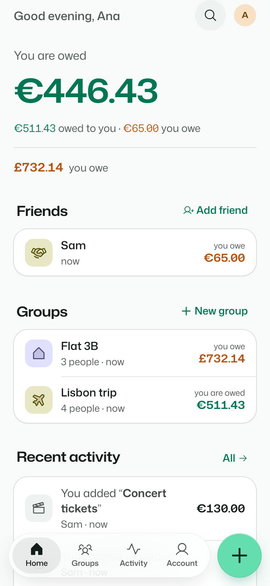
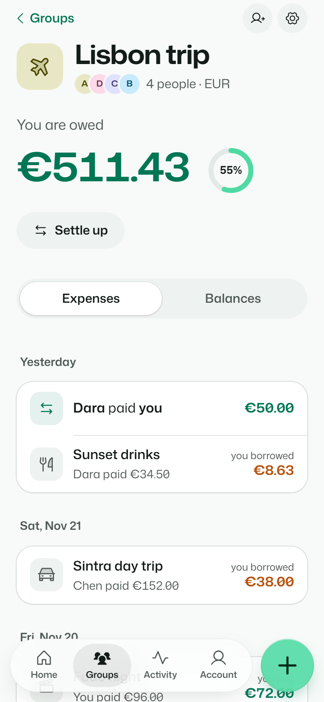
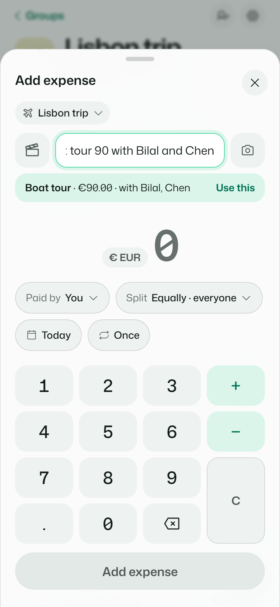
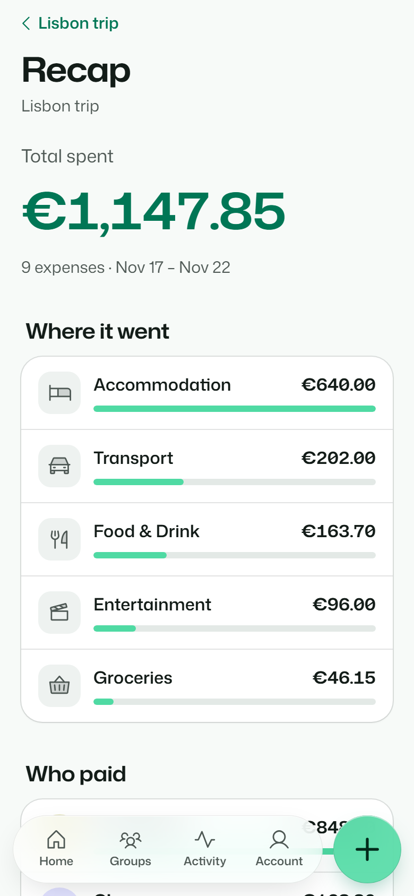

<div align="center">


# SettleMint

**Split expenses, not friendships.**

Track who paid what and who owes whom, in any currency, exact to the cent.
A fast web app and a phone app, free to use and built to work offline.

[](https://github.com/umair363/SettleMint/actions/workflows/ci.yml)


[Features](#features) ·
[Architecture](#architecture) ·
[Getting started](#getting-started) ·
[Testing](#testing) ·
[Configuration](#configuration) ·
[Deployment](docs/deploy.md) ·
[Contributing](CONTRIBUTING.md)

</div>

<br />

<table>
  <tr>
    <td width="25%"></td>
    <td width="25%"></td>
    <td width="25%"></td>
    <td width="25%"></td>
  </tr>
  <tr>
    <td align="center"><sub>Where you stand</sub></td>
    <td align="center"><sub>A group</sub></td>
    <td align="center"><sub>Type it like a message</sub></td>
    <td align="center"><sub>Where it all went</sub></td>
  </tr>
</table>

## Features

**Adding and splitting**

- **Fast.** An amount-first keypad with quick sums (`12+8.50`), sensible defaults and a
  category guessed from what you type. Write "Dinner 45 with Sam" and the form fills itself in.
- **Every split.** Equally, exact amounts, percentages, shares, adjustments, or item by item
  from a scanned receipt with tax and tip shared fairly, with one or several payers. A preview
  always equals what is saved, to the cent.
- **150+ currencies.** The exchange rate is locked when an expense is added, so a trip's
  balances never drift.
- **Repeating bills.** Rent and subscriptions add themselves weekly, monthly or yearly, on the
  right day in your time zone.

**Friends, groups and people**

- **Friends without groups.** Add a friend with just a name and split with them directly.
- **Groups** for trips, homes, couples and events. Friends join from a link and pick their
  name; no account needed, and they can save one later.
- **One balance per person.** See what someone owes you, or you owe them, added up across
  every group you share.
- **Recap.** Where a group's money went and who paid, shareable as an image.

**Settling up**

- **Fewest payments.** Debt simplification that is provably minimal for groups of up to 16
  people, or exact who-owes-whom if you prefer.
- **Get paid, not just reminded.** Add how you like to be paid (UPI, PayPal, Venmo, Cash App,
  Revolut, Monzo, Wise, IBAN, Raast, JazzCash, Easypaisa and more). Whoever settles with you
  gets a one-tap link with the amount filled in. SettleMint never touches the money.
- **Your own QR code.** Upload the QR your bank or wallet app made (Raast, JazzCash, any bank).
  It is read on your device, stored as text and redrawn sharply in the app's style; friends scan
  it, or save and share it as a picture. Or make one from details you already entered: a
  Pakistani IBAN (the State Bank's personal-QR format), a European IBAN, UPI or a payment link.
- **Reminders that don't point fingers.** One tap sends a notification and an email that say a
  payment is waiting, never who is asking. Add your payment details and QR if you like. One
  reminder per person per day, and a one-click link stops the emails.
- **Switch from Splitwise in a minute.** Import a group export; balances come over to the cent.

**Trust**

- **Nothing is lost.** Full history on every expense, undo on delete, and a "Recently deleted"
  list that restores anything from the last 30 days. Edit conflicts are caught, not overwritten.
- **Your data is yours.** Export everything as JSON, or delete your account; friends' balances
  stay correct.
- **Works offline.** Opens instantly from saved data, and anything added offline syncs later.
  Changes from other people appear live.
- **Eight languages**, fully right-to-left for Arabic and Urdu: English, Spanish, Portuguese,
  French, German, Hindi, Urdu and Arabic. Numbers, money and dates follow your region.
- **Accessible.** WCAG 2.2 AA colour, keyboard and screen-reader support, reduced motion and
  reduced transparency honoured.

## Architecture

```
web/        Next.js 16 static PWA · Tailwind v4 · Radix · Motion      → Cloudflare Pages
api/        Fastify 5 · Drizzle · Postgres · Better Auth               → Render
mobile/     Expo SDK 57 · Expo Router · React Native                   → App Store / Google Play (EAS)
packages/
  shared/   money engine · API contracts (Zod) · typed API client
  client/   what web and mobile share above the API: translations, data hooks,
            text helpers and the design tokens
docs/       product brief, architecture notes, deployment guide
```

Three ideas shape the codebase. See [docs/architecture.md](docs/architecture.md) for the detail.

- **One money engine.** Money is always integer minor units plus an ISO currency code.
  Splitting, conversion and balancing live in `packages/shared` and run identically on the
  server, the web app and the phone app. Property tests check thousands of random cases.
- **One set of design tokens.** Colours, type, spacing and motion are defined once in
  `packages/client/src/design/tokens.ts` and generated into the website's CSS and the phone
  app's palette, so the two always match.
- **A small, strict API.** Every group route passes one membership gate (outsiders get 404),
  clients make their own ids so offline retries never duplicate, and edits carry versions.

## Getting started

You need Node 24 and npm. No database is required for development.

```bash
npm install
npm run dev:v1     # API on http://localhost:8001 (a local embedded database)
npm run dev:web    # web app on http://localhost:3001
```

Without an email key, sign-in and confirmation codes are printed in the API's console.
Copy `api/.env.example` to `api/.env` and `web/.env.example` to `web/.env.local` to change
settings.

**Phone app.** Copy `mobile/.env.example` to `mobile/.env` and point `EXPO_PUBLIC_API_URL` at
your computer's network address, since a phone can't reach `localhost`. Then run
`npm run dev:mobile`. See [mobile/README.md](mobile/README.md) for devices and builds.

### Scripts

| Command | What it does |
| --- | --- |
| `npm run dev:v1` | API with automatic reload |
| `npm run dev:web` | Web app with hot reload |
| `npm run dev:mobile` | Phone app (Expo) |
| `npm run typecheck` | Type-check shared, client, api, web and mobile |
| `npm test` | Money-engine and API integration tests |
| `npm run lint` | Lint the web app |
| `npm run db:up` | Optional: a local Postgres in Docker |

## Testing

```bash
npm run typecheck
npm test
npm run lint
```

- **Unit and integration:** the money engine and every API route, on an in-memory Postgres.
- **Browser (Playwright):** `web/e2e` covers the main flow, offline sync, live updates,
  notifications, language switching, saved QR codes and reminders (including a scan test of the
  redrawn code) and an axe-core accessibility audit of every screen in both themes. See [web/e2e/README.md](web/e2e/README.md).
- **Phone app:** `mobile/e2e/smoke.mjs` drives the app's web build, which renders the same
  screens, from sign-in to settling up, in English and Arabic.

CI runs all of this on every push and pull request.

## Configuration

All settings are environment variables; every one is optional for local development.
The `.env.example` file in each app documents them in full.

| Variable | App | Purpose |
| --- | --- | --- |
| `V1_DATABASE_URL` | api | Postgres connection (an embedded database is used when empty) |
| `AUTH_SECRET` | api | Signs sessions. 32+ random characters, required in production |
| `WEB_ORIGINS` | api | Web origins allowed to call the API with cookies |
| `COOKIE_DOMAIN` | api | Shares the session between the site and the API subdomain |
| `RESEND_API_KEY` | api | Sends sign-in, confirmation and reminder emails |
| `GEMINI_API_KEY` | api | Turns on receipt scanning |
| `VAPID_PUBLIC_KEY` / `VAPID_PRIVATE_KEY` | api | Web push notifications |
| `NEXT_PUBLIC_API_URL` | web | Where the API lives |
| `NEXT_PUBLIC_SITE_URL` | web | The site's own address (canonical links, sitemap) |
| `EXPO_PUBLIC_API_URL` | mobile | Where the API lives |

## Documentation

- [Product brief](docs/product.md): who it is for and the principles behind it
- [Architecture](docs/architecture.md): how the pieces fit together
- [Deployment](docs/deploy.md): running it on free hosting
- [Security](SECURITY.md): how data is protected, and how to report a problem
- [Contributing](CONTRIBUTING.md): how to work on the project

<br />

<div align="center">
<sub>Built by <a href="https://github.com/umair363">Umair</a></sub>
</div>
